# 🍞 Kinder der Cordula

*Dein Sauerteig-Starter und zwei Brotrezepte*

Herzlichen Glückwunsch, du hast ein Kind von Cordula adoptiert! In diesem Glas steckt lebendiger Sauerteig, das sogenannte **Anstellgut (ASG)**. Mit ein bisschen Pflege backst du damit richtig gutes Brot, und du kannst ihn jahrelang am Leben halten.

---

## Los geht's

### 1. Gib deinem Sauerteig einen Namen

Meiner heißt Cordula, deiner darf auch einen eigenen Namen bekommen. Das macht das Weiterfüttern leichter, und man vergisst ihn nicht so schnell.

### 2. Erst auffrischen, dann backen

Bevor du das erste Rezept probierst, **frischst du das Anstellgut auf** und wartest, bis es sich verdoppelt hat. Erst dann wird gebacken. Die Anleitung dazu steht direkt darunter.

---

## Was ist Anstellgut (ASG)?

Das ASG ist der lebendige Teig aus Mehl und Wasser, in dem Hefen und Milchsäurebakterien leben. Mit einer kleinen Menge davon setzt du jedes Sauerteig-Rezept an. Ein kleiner Rest wird immer aufbewahrt und weitergefüttert, so lebt der Sauerteig weiter.

Der Sauerteig, den du geschenkt bekommen hast, ist Überschuss aus meinem Glas. Deshalb sollte **jeder zu Beginn sein ASG einmal auffrischen**. Was dabei übrig bleibt, wird weggeworfen.

---

## Auffrischen

1. **Neues Glas auskochen** (oder mit kochendem Wasser ausspülen).
2. **5 g altes Anstellgut** hineingeben.
3. Mit **je 25 g Roggenmehl und 25 g Wasser** mischen.
4. Bei Zimmertemperatur stehen lassen. Nach **ca. 6 Stunden**, wenn sich das Volumen verdoppelt hat, kommt das Glas **in den Kühlschrank**.

**Wie oft?** Mindestens **1x pro Woche** auffrischen.

**Fürs Backen** nimmst du das ASG immer erst nach der Reife (ca. 6 h, verdoppelt) oder frisch aus dem Kühlschrank.

Das Verhältnis ist dasselbe wie beim [Sauerteig im Roggenbrot](#schritt-1-der-sauerteig) (1 Teil Anstellgut : 5 Teile Mehl : 5 Teile Wasser), nur die Mengen sind kleiner.

---

## Die Basics

- **Wasser immer abwiegen!**
- **Anfangs gerne 10 % des Wassers zurückhalten.** Die richtige Wassermenge hängt immer vom Mehl ab. Mit etwas weniger Wasser ist der Teig leichter zu handhaben, das ist anfängerfreundlich. Wenn der Teig zu fest ist, kannst du das restliche Wasser nach und nach dazugeben.
- **Das Sauerteig-Glas nie zuschrauben**, Deckel nur auflegen. Der Sauerteig produziert Gase.
- **Teig immer abdecken.** Sonst trocknet die Oberfläche an und bildet eine Haut, die sich später nicht mehr gut verbindet und im Brot harte Stellen hinterlässt. Geeignet sind ein Teller oder Deckel auf der Schüssel, eine Duschhaube, ein feuchtes Küchentuch oder Frischhaltefolie (locker, nicht fest aufdrücken). Bei allem, was gärt, gilt: Der Abschluss muss locker sein, nie luftdicht.
- **Hände immer anfeuchten oder bemehlen**, wenn der Teig klebrig ist.
- **Roggen klebt immer.** Er bildet keine Struktur wie Weizen und muss deshalb nur vermischt werden, nicht geknetet.
- **Temperatur:** Alle Zeitangaben gelten bei ca. **22 °C** Raumtemperatur. Ist es wärmer, geht es schneller, ist es kälter, dauert es länger.
- **Übergare ist besser als Untergare.** Im Zweifel lieber länger gehen lassen, aber nicht übertreiben (siehe Hinweis beim Weizenbrot).
- **Geduld:** In den ersten Stunden passiert im Teig sichtbar wenig. Die Volumenzunahme kommt erst gegen Ende. Nicht nervös werden und nicht zu früh aufgeben.

---

## Woran erkenne ich, dass der Sauerteig fit ist?

- Er hat sichtbar **Blasen**.
- Er hat sich ungefähr **verdoppelt**.
- Er riecht angenehm **säuerlich-fruchtig** (nicht nach Nagellackentferner und nicht nach Schimmel).

## Was tun, wenn ...

| Problem | Was du tun kannst |
|---|---|
| Dunkle Flüssigkeit oben (Hungerwasser) | Unterrühren oder abgießen, dann auffrischen. |
| Der Sauerteig verdoppelt sich nicht | Meist zu kalt. Wärmer stellen und länger warten. |
| Flaumiger, farbiger Belag (Schimmel) | Wegwerfen und neu anfangen. |

---

# Rezept 1: Roggenbrot

**Schwierigkeit:** leicht. Der Teig wird nur gemischt, nicht geknetet.

Du brauchst eine **Kastenform (ca. 25 cm)**.

## Schritt 1: Der Sauerteig

**Zutaten**

- 30 g Anstellgut (ASG)
- 150 g Wasser, warm (ca. 35 °C)
- 150 g Roggenmehl (Type 1150, Vollkorn oder eine Mischung)

**Zubereitung**

Alles vermischen und **abgedeckt** (Deckel nur auflegen) **10-14 Stunden** stehen lassen. Der Sauerteig muss sich **verdoppeln**.

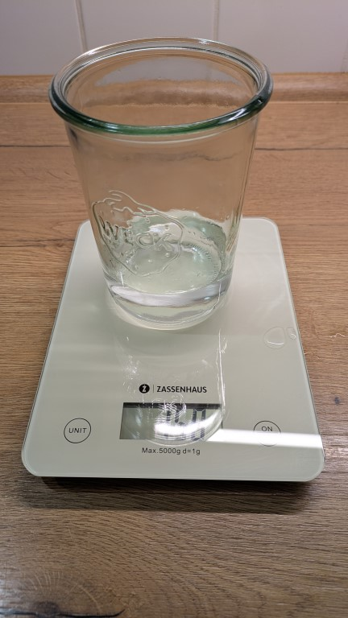
*Sauerteig 1*

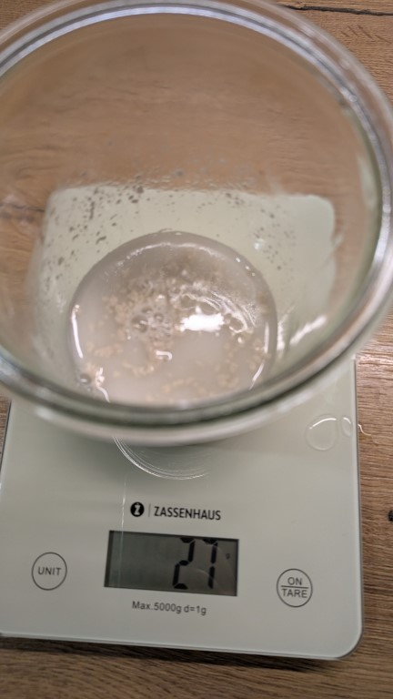
*Sauerteig 2*

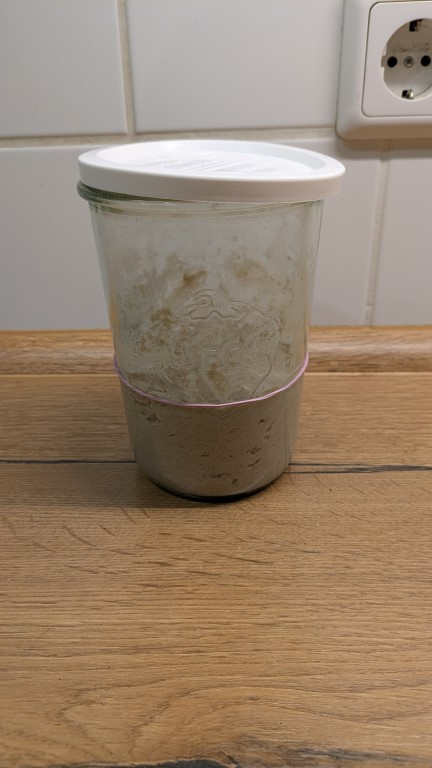
*Sauerteig 3*

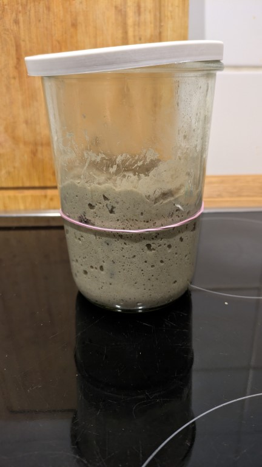
*Sauerteig 4 – nach 3 Stunden*

*Sauerteig 5 – nach 12 Stunden*

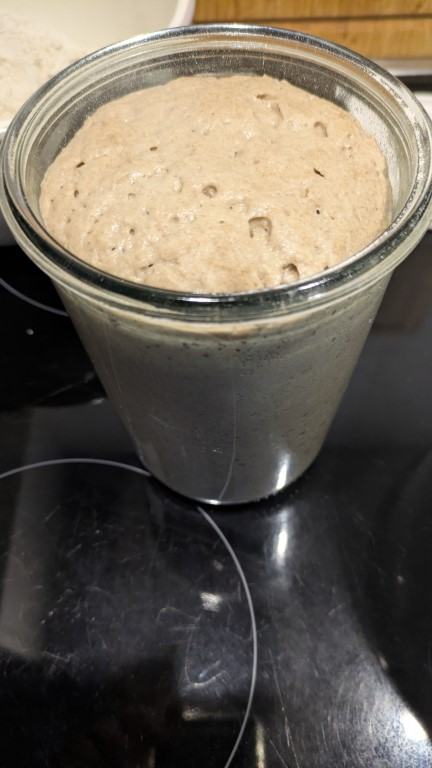
*Sauerteig 6 – nach 12 Stunden*

## Schritt 2: Der Hauptteig

**Zutaten**

- 350 g Wasser, warm
- 450 g Roggenmehl (Type 1150, Vollkorn oder eine Mischung)
- der Sauerteig aus Schritt 1
- 12 g Salz

**Zubereitung**

1. Alles vermischen, entweder mit der Küchenmaschine oder mit einem Löffel in einer Schüssel. Roggen muss nicht geknetet werden.
2. Der Teig ist klebrig, das ist normal. Hände anfeuchten oder bemehlen.
3. **90 Minuten abgedeckt** gehen lassen.
4. In die Kastenform füllen (ausfetten und leicht bemehlen ODER mit Backpapier auslegen), mit einem Tuch oder einer Haube abdecken und nochmal **1 Stunde** gehen lassen.

*Wasser und Sauerteig gut verrühren.*

*Mehl und Salz zum Wasser-Sauerteig-Gemisch geben.*

*Alles mit einem Löffel zu einem gleichmäßigen, klebrigen Teig vermischen.*

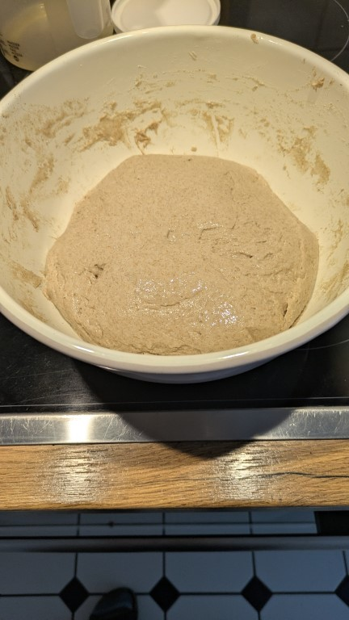
*Der Hauptteig ist glatt und ruht in der Schüssel.*

*Der Teig liegt nach dem Füllen und der anschließenden Ruhezeit in der Kastenform.*

## Schritt 3: Backen

Ober-/Unterhitze, **Backzeit gesamt: 50 Minuten**.

1. Ofen auf **230 °C** vorheizen. Eine **leere, feuerfeste Schale** (am besten aus Metall, Glas kann springen) auf den Ofenboden stellen und mit vorheizen.
2. Kasten in den Ofen schieben und **sofort heißes Wasser in die Schale gießen** (ca. eine halbe Tasse, Vorsicht, es dampft stark). Tür schnell schließen und **20 Minuten bei 230 °C mit Dampf** backen.
3. **Dampf ablassen** (Ofentür kurz öffnen) und auf **210 °C** reduzieren. Die Schale kann im Ofen bleiben oder mit Ofenhandschuhen vorsichtig herausgenommen werden.
4. Weitere **30 Minuten** backen.

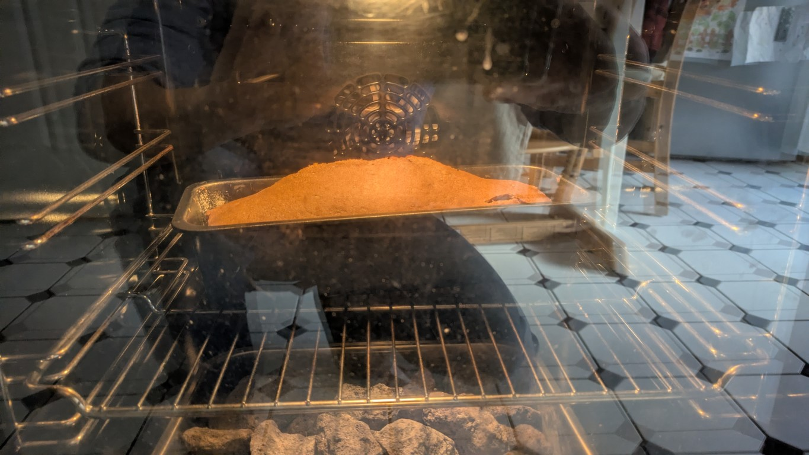
*Das Roggenbrot backt im Ofen.*

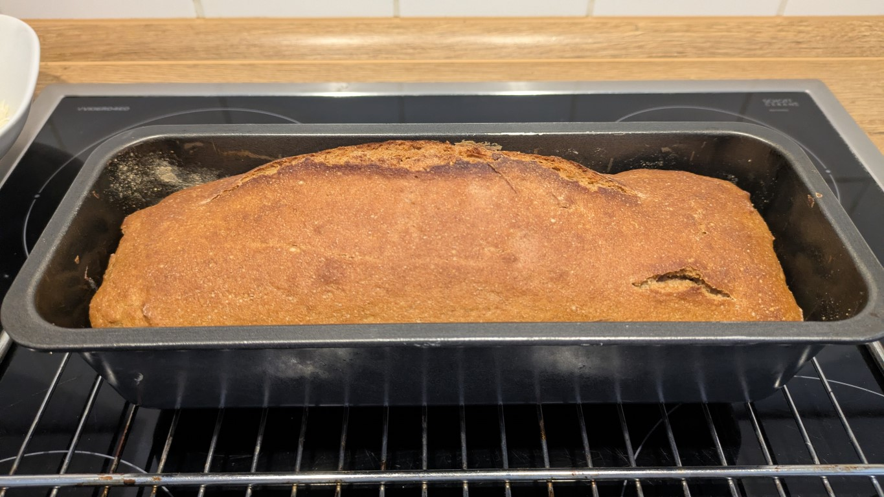
*Das fertig gebackene Roggenbrot in der Kastenform.*

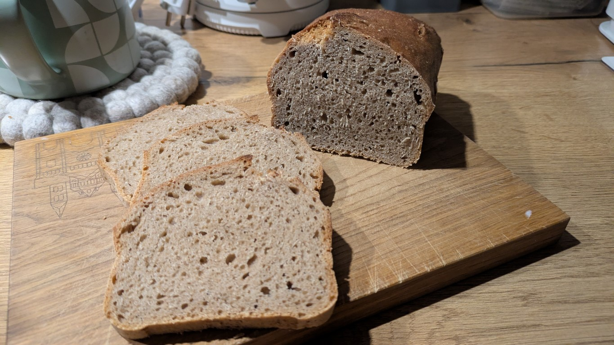
*Das Roggenbrot aufgeschnitten und servierfertig.*

## Wichtig: Abkühlen lassen!

Roggenbrot muss **mindestens 12 Stunden** auskühlen, bevor du es anschneidest.

**Warum so lange warten?** Roggenbrot hat kaum Kleber wie Weizen, seine Struktur kommt aus verkleisterter Stärke und gequollenen Mehlbestandteilen. Direkt nach dem Backen ist die Krume noch feucht und weich. Erst beim Auskühlen verteilt sich die Feuchtigkeit und die Krume wird fest. Wer zu früh anschneidet, bekommt eine klebrige, gummiartige Krume, auch wenn das Brot perfekt gebacken ist.

---

# Rezept 2: Weizenbrot („Home Office Brot“)

**Schwierigkeit:** anspruchsvoller als Rezept 1. Du musst **kneten, dehnen und falten, formen** und brauchst am besten ein **Gärkörbchen**. Probier zuerst das Roggenbrot.

**Voraussetzungen:** ein Gärkörbchen (oder eine Alternative, siehe Schritt 3) und **1 Tag Homeoffice 🙂**

## Schritt 1: Der Vorteig (über Nacht)

**Zutaten**

- 10 g Anstellgut (ASG)
- 100 g Wasser
- 100 g Weizenvollkornmehl

**Zubereitung**

Alles vermischen und **abgedeckt** (Deckel nur auflegen) über Nacht (ca. **12 Stunden**) stehen lassen.

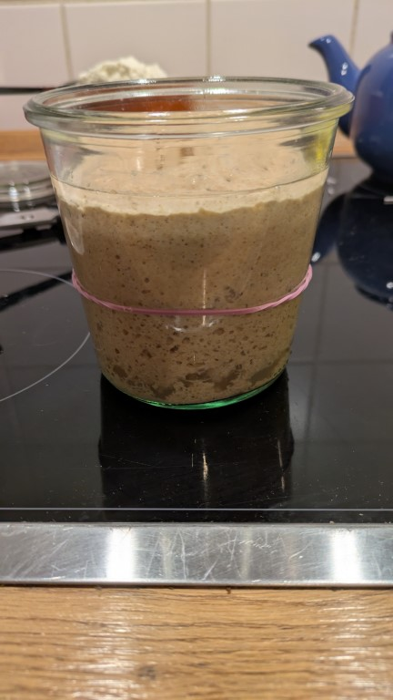
*Der Vorteig nach der Nacht.*

## Schritt 2: Der Hauptteig

**Zutaten**

- der Vorteig
- 400 g Weizenmehl Type 550
- 10 g Salz
- 235 g Wasser

**Zubereitung**

1. Alles mischen und **10-15 Minuten kneten**. Wenn du nicht ausgiebig kneten möchtest, kannst du den Teig auch erstmal nur zusammenmischen und **10-15 Minuten stehen lassen**.

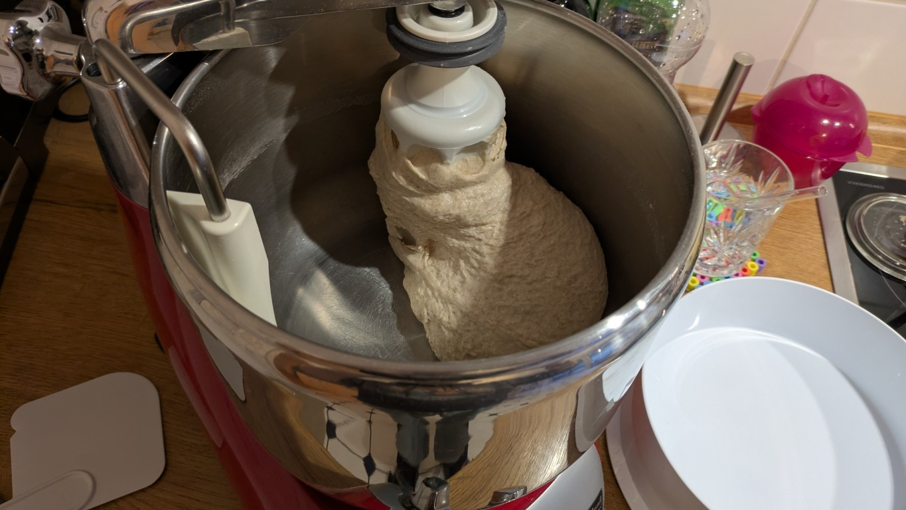
*Der Hauptteig ist fertig verknetet.*

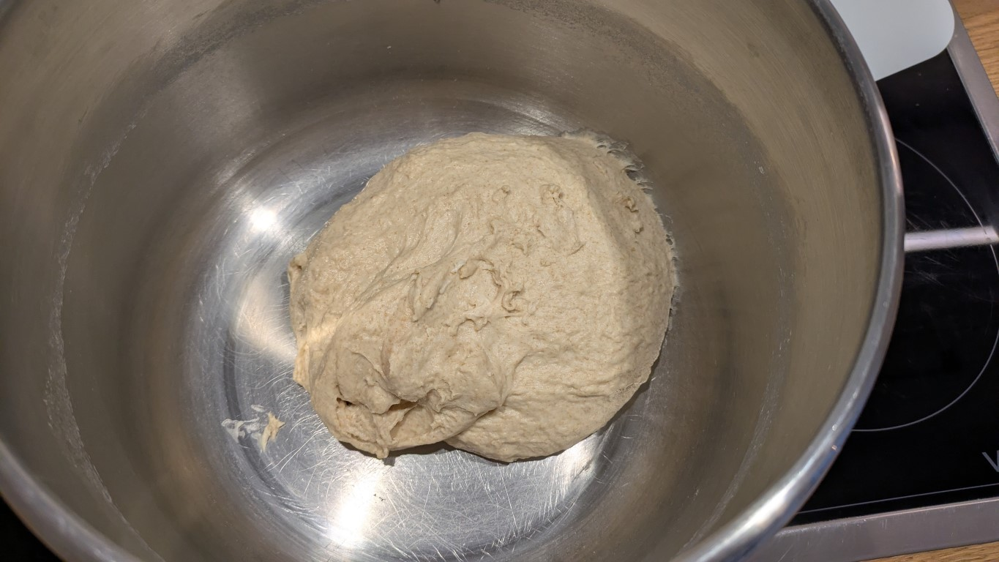
*Der Hauptteig ruht nach dem Kneten in der Schüssel.*

2. **2 Stunden abgedeckt ruhen** lassen. In dieser Zeit alle **30 Minuten dehnen und falten**: Den Teig an einer Seite hochziehen, dehnen und über sich falten, dann die Schüssel eine Vierteldrehung weiterdrehen und wiederholen (rundherum). Dazu den Teig nur kurz aufdecken und danach wieder abdecken.

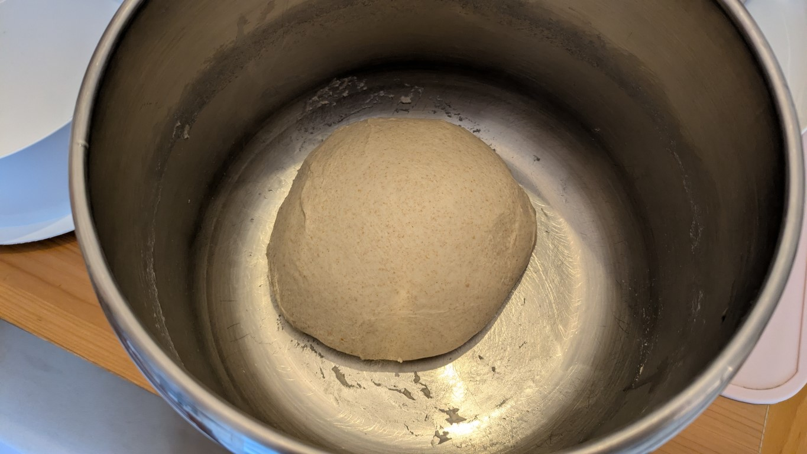
*Dehnen und Falten, erste Runde.*

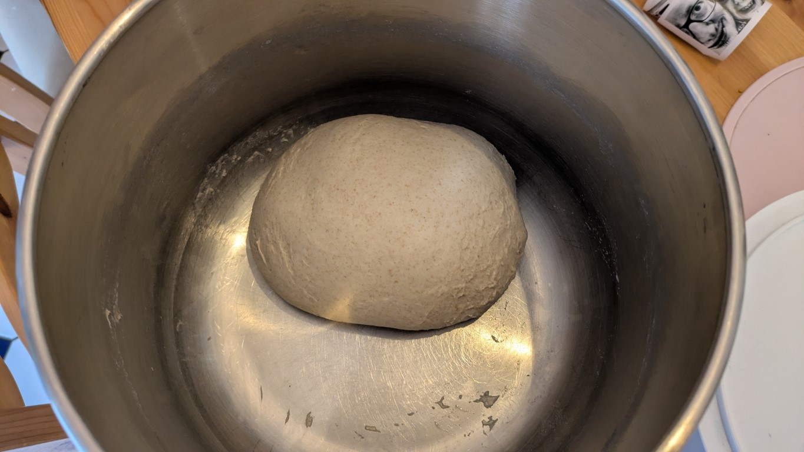
*Dehnen und Falten, spätere Runde.*

▶️ **Video:** [Beispiel für Dehnen und Falten](https://www.youtube.com/shorts/LgPSulSaJ38) (im Video ist es Pizzateig, das Prinzip ist dasselbe)

3. Danach den Teig **abgedeckt** weiter gehen lassen (Stockgare): bei ca. 22 °C **ca. 3 Stunden**, bis der Teig ca. **60 % an Volumen** gewonnen hat. Insgesamt sind das **ca. 5 Stunden ab dem Ende des Knetens** (inklusive der 2 Stunden Ruhe mit Dehnen und Falten). Auch hier gilt: Die Volumenzunahme kommt erst gegen Ende.

> **Profi-Tipp (Aliquot-Methode):** Gib ein Stück Teig (ca. 20 g) in ein kleines Glas (Deckel nur locker auflegen) und markiere die Höhe. Wenn der Teig im Glas um 60 % gewachsen ist, ist auch der große Teig so weit. Das ist verlässlicher als jede Uhrzeit.

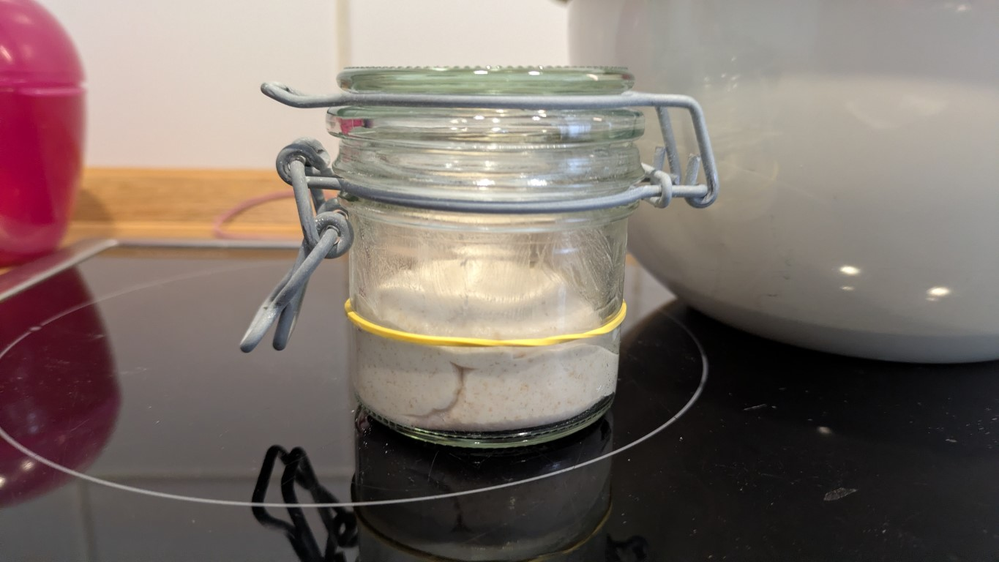
*Das Aliquot-Glas mit markierter Starthöhe.*

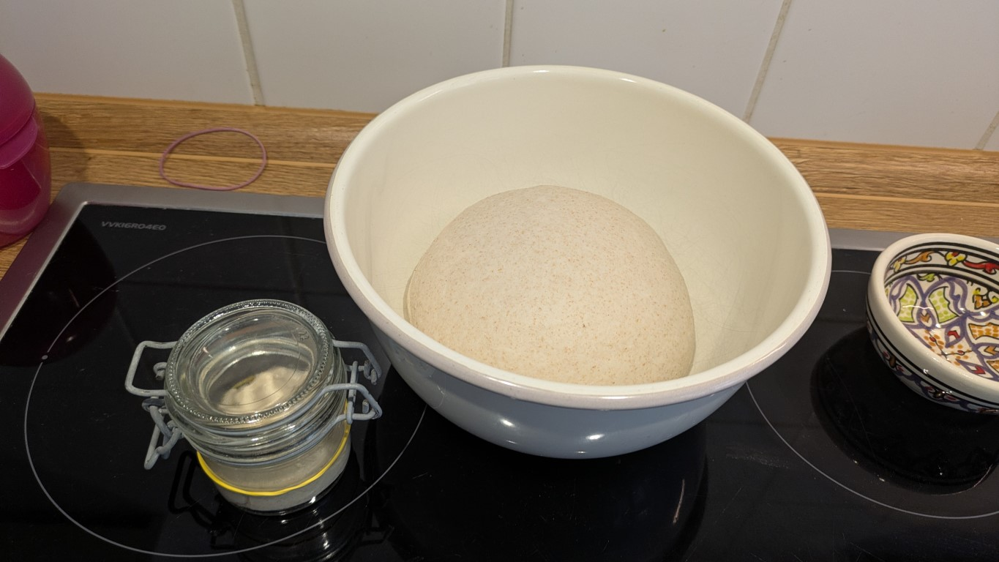
*Der Teig zu Beginn der Stockgare.*

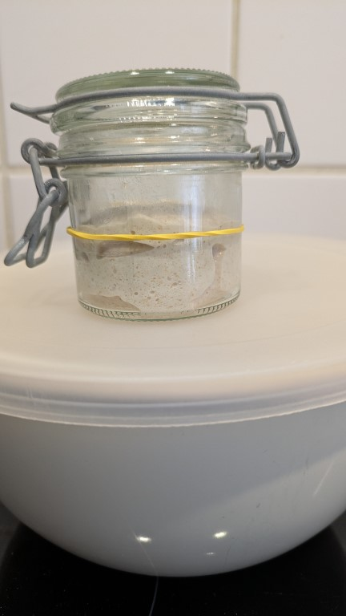
*Die Stockgare nach 4 Stunden.*

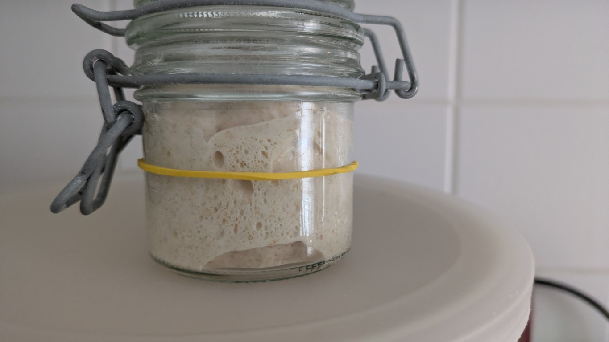
*Das Aliquot-Glas nach 6 Stunden.*

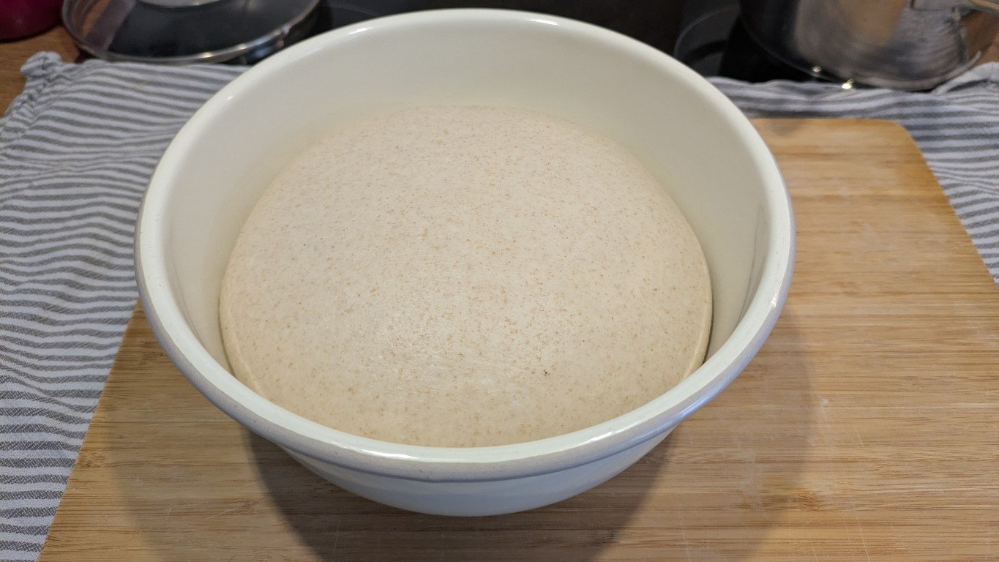
*Der Teig in der Schüssel nach 6 Stunden.*

> **Mein Backversuch:** Ich habe die Stockgare insgesamt **6 Stunden** ab dem Ende des Knetens gehen lassen (es ging bei mir zeitlich nicht anders). Das war zu viel, **5 Stunden hätten gereicht**. Bei Weizen gilt „im Zweifel länger“ also nur eingeschränkt. Schau lieber auf das Volumen als auf die Uhr.

## Schritt 3: Formen und kalt gehen lassen

1. Teig vorsichtig auf die Arbeitsfläche geben und zu einer Kugel oder einem Oval formen. Bei der Aliquot Methode kann man den entfernten Teig hier auf die Unterseite des Teiges machen.

▶️ **Video:** [So wird der Teig geformt](https://www.youtube.com/watch?v=h7eqwYLv2tI) (die einfache Technik im Video reicht)

2. In ein **gut bemehltes Gärkörbchen** legen, mit dem Schluss (der Nahtstelle) nach oben. Zum Bemehlen eignet sich **Reismehl** am besten, danach **Roggenmehl** (auch Vollkorn) und als letzte Lösung **Weizenmehl**. Wenn du später **ohne Backpapier** backst, bemehle auch die **Unterseite** des Teiges (die Schlussseite, die im Körbchen oben liegt) gut, sonst klebt das Brot beim Backen fest. Mit Backpapier ist das nicht nötig, das ist für Anfänger einfacher.

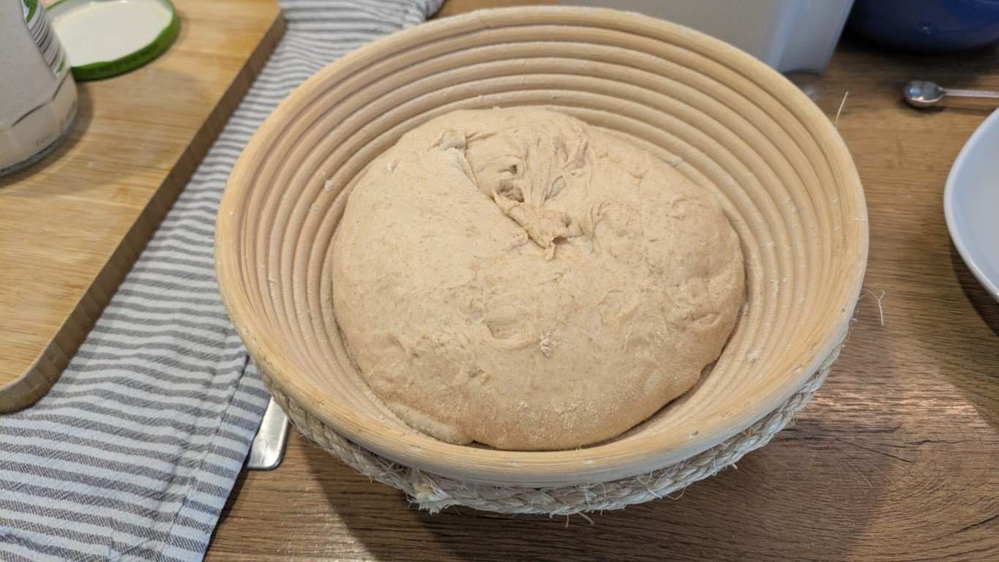
*Der geformte Teig im Gärkörbchen.*

3. Abdecken (Tüte, Duschhaube oder Tuch), damit der Teig im Kühlschrank nicht austrocknet, und **über Nacht in den Kühlschrank** stellen.

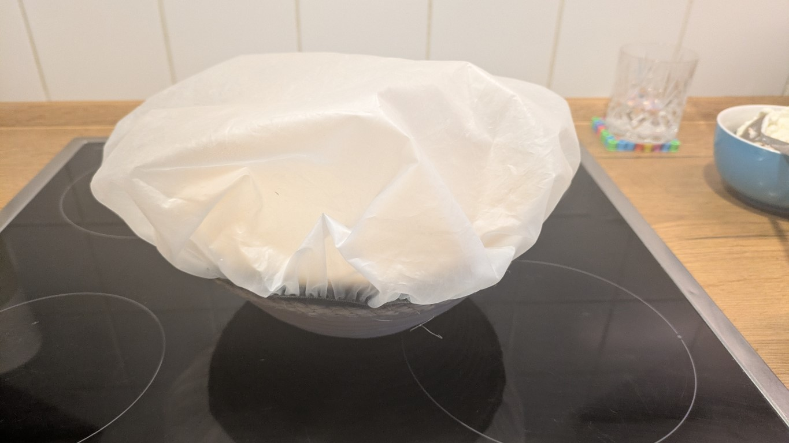
*Das Gärkörbchen ist mit einer Haube abgedeckt.*

**Kein Gärkörbchen?** Das geht auch mit:

- einer Schüssel mit einem gut bemehlten (oder mit Leinen ausgelegten) Küchentuch, am besten in der Größe des Brotes,
- einem Sieb mit Küchentuch,
- einer Kastenform (dann wird es ein Kastenbrot statt eines runden Laibs).

## Schritt 4: Backen (irgendwann am nächsten Tag)

Der Teig kann direkt aus dem Kühlschrank gebacken werden.

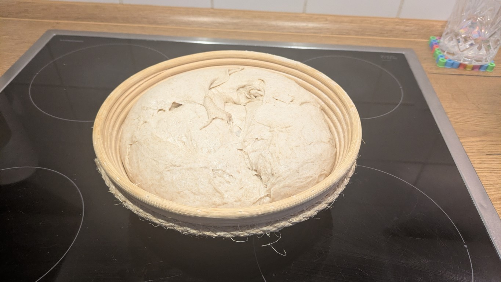
*Der Teig am nächsten Tag direkt aus dem Kühlschrank.*

**Ohne Topf (Standard):**

Backen mit einem **Pizzastein** gelingt am besten, ein **umgedrehtes Backblech** geht aber auch. Der Pizzastein muss länger vorheizen als das Blech.

**Backen auf Backpapier** ist einfacher und für Anfänger empfehlenswert: Du stürzt den Teig auf das Papier und schiebst ihn mit dem Papier in den Ofen. Ohne Backpapier muss die Unterseite des Teiges vorher gut bemehlt sein (siehe Schritt 3).

1. **Pizzastein** oder **umgedrehtes Backblech** und eine **leere, feuerfeste Schale** (am besten aus Metall) auf dem Ofenboden im Ofen mit vorheizen. Ofen auf **230 °C** Ober-/Unterhitze. Der Pizzastein braucht dafür **mindestens 30-45 Minuten**, beim Backblech reichen **ca. 15-20 Minuten**.
2. Teig aus dem Gärkörbchen auf Backpapier stürzen und mit einem sehr scharfen Messer oder einer Rasierklinge ca. 0,5 cm tief einschneiden. Der Teig kann alternativ auch nach **6 Minuten Backzeit** eingeschnitten werden.

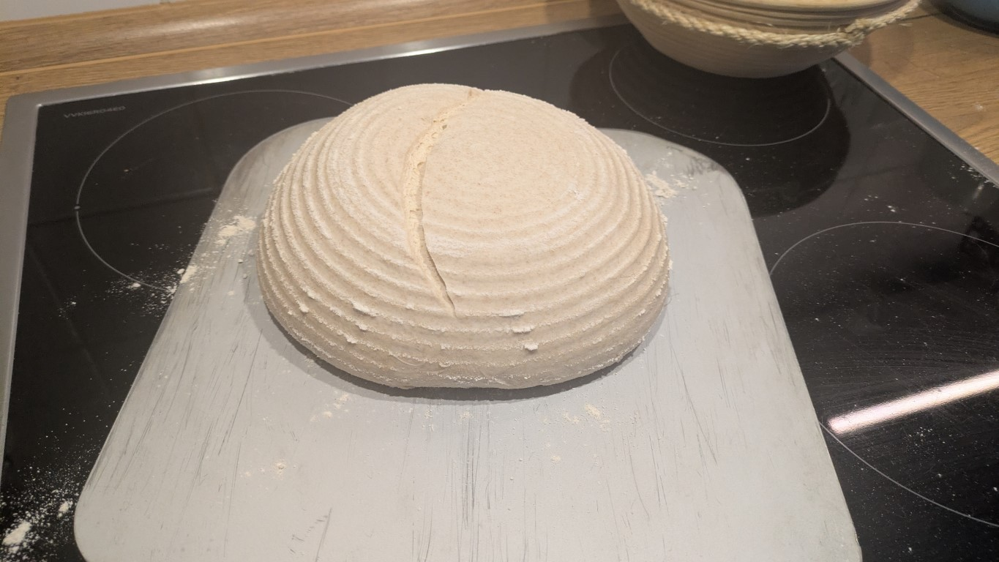
*Der Teig mit Einschnitt.*

3. Mit dem Papier auf den heißen Pizzastein (oder das heiße Backblech) schieben, **sofort heißes Wasser in die Schale gießen** (Vorsicht, es dampft stark), Tür schließen und **20 Minuten bei 230 °C mit Dampf** backen.

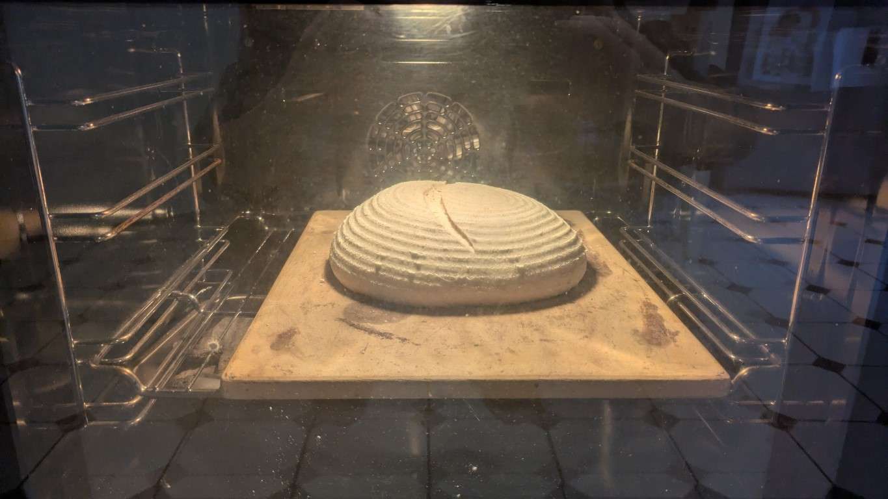
*Der Teig direkt nach dem Einschieben in den Ofen.*

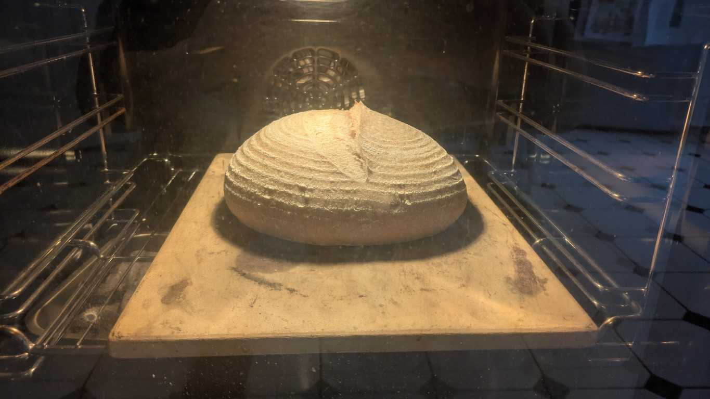
*Der Teig nach 10 Minuten im Ofen.*

4. Dampf ablassen (Ofentür kurz öffnen) und auf **210 °C** reduzieren. Die Schale kann im Ofen bleiben. Weitere **25-30 Minuten** backen, bis die Kruste schön braun ist.

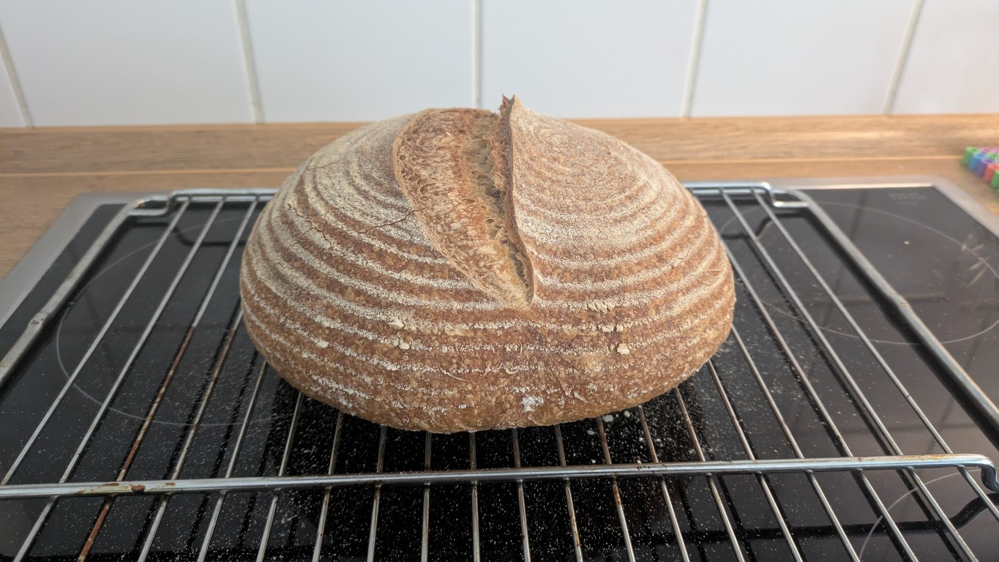
*Das fertig gebackene Weizenbrot.*

5. Auf einem Gitter mindestens **1 Stunde** auskühlen lassen.

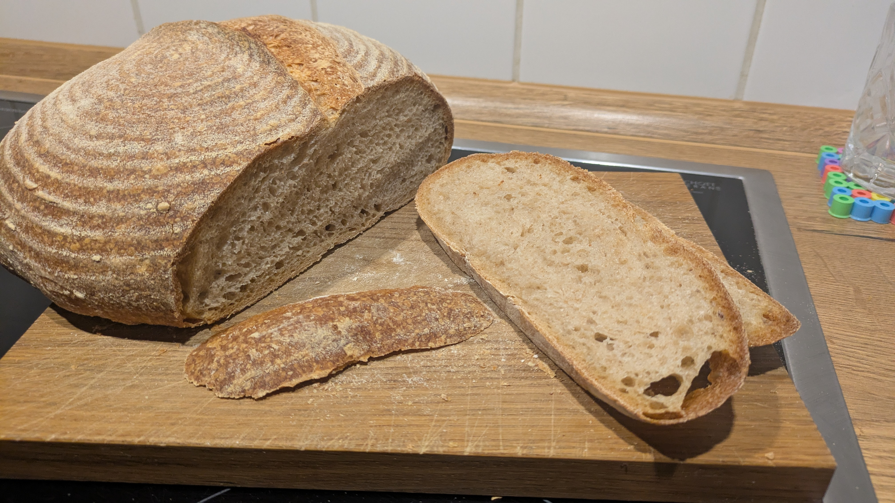 

**Mit Topf (optional, bessere Kruste):** Wer einen Gusseisentopf oder einen anderen ofenfesten Topf mit Deckel hat, kann das Brot darin backen:

1. Topf mit Deckel im Ofen bei **250 °C** mindestens 30-45 Minuten vorheizen.
2. Teig auf Backpapier stürzen und einschneiden, mit dem Papier in den heißen Topf heben (Vorsicht, heiß!).
3. Deckel drauf, Ofen auf **230 °C** stellen und **20 Minuten** backen.
4. Deckel abnehmen, bei **210 °C** weitere **20-25 Minuten** backen.
5. Auf einem Gitter mindestens **1 Stunde** auskühlen lassen.

---

Viel Spaß beim Backen und beim Pflegen deines Sauerteigs! 🥖