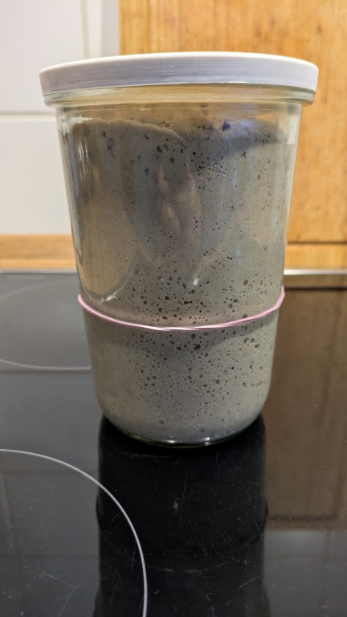
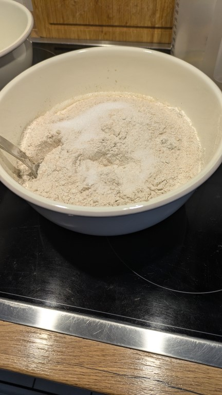
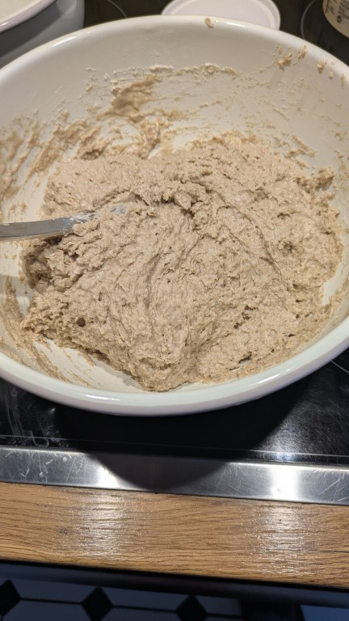
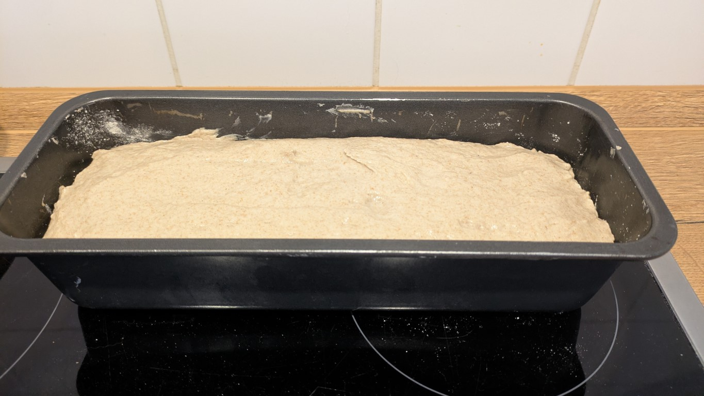

# 🍞 Kinder der Cordula

*Dein Sauerteig-Starter und zwei Brotrezepte*

Herzlichen Glückwunsch, du hast ein Kind von Cordula adoptiert! In diesem Glas steckt lebendiger Sauerteig, das sogenannte **Anstellgut (ASG)**. Mit ein bisschen Pflege backst du damit richtig gutes Brot, und du kannst ihn jahrelang am Leben halten.

---

## Los geht's

### 1. Gib deinem Sauerteig einen Namen

Meiner heißt Cordula, deiner darf auch einen eigenen Namen bekommen. Das macht das Weiterfüttern leichter, und man vergisst ihn nicht so schnell.

### 2. Erst auffrischen, dann backen

Bevor du das erste Rezept probierst, **frischst du das Anstellgut auf** und wartest, bis es sich verdoppelt hat. Erst dann wird gebacken. Die Anleitung dazu steht direkt darunter.

---

## Was ist Anstellgut (ASG)?

Das ASG ist der lebendige Teig aus Mehl und Wasser, in dem Hefen und Milchsäurebakterien leben. Mit einer kleinen Menge davon setzt du jedes Sauerteig-Rezept an. Ein kleiner Rest wird immer aufbewahrt und weitergefüttert, so lebt der Sauerteig weiter.

Der Sauerteig, den du geschenkt bekommen hast, ist Überschuss aus meinem Glas. Deshalb sollte **jeder zu Beginn sein ASG einmal auffrischen**. Was dabei übrig bleibt, wird weggeworfen.

---

## Auffrischen

1. **Neues Glas auskochen** (oder mit kochendem Wasser ausspülen).
2. **5 g altes Anstellgut** hineingeben.
3. Mit **je 25 g Roggenmehl und 25 g Wasser** mischen.
4. Bei Zimmertemperatur stehen lassen. Nach **ca. 6 Stunden**, wenn sich das Volumen verdoppelt hat, kommt das Glas **in den Kühlschrank**.

**Wie oft?** Mindestens **1x pro Woche** auffrischen.

**Fürs Backen** nimmst du das ASG immer erst nach der Reife (ca. 6 h, verdoppelt) oder frisch aus dem Kühlschrank.

Das Auffrischen ist im Prinzip dasselbe wie beim [Sauerteig im Roggenbrot](#schritt-1-der-sauerteig).

---

## Die Basics

- **Wasser immer abwiegen!**
- **Anfangs gerne 10 % des Wassers zurückhalten.** Die richtige Wassermenge hängt immer vom Mehl ab. Mit etwas weniger Wasser ist der Teig leichter zu handhaben, das ist anfängerfreundlich. Wenn der Teig zu fest ist, kannst du das restliche Wasser nach und nach dazugeben.
- **Das Sauerteig-Glas nie zuschrauben**, Deckel nur auflegen. Der Sauerteig produziert Gase.
- **Hände immer anfeuchten oder bemehlen**, wenn der Teig klebrig ist.
- **Roggen klebt immer.** Er bildet keine Struktur wie Weizen und muss deshalb nur vermischt werden, nicht geknetet.
- **Temperatur:** Alle Zeitangaben gelten bei ca. **22 °C** Raumtemperatur. Ist es wärmer, geht es schneller, ist es kälter, dauert es länger.
- **Übergare ist besser als Untergare.** Im Zweifel lieber länger gehen lassen.
- **Geduld:** In den ersten Stunden passiert im Teig sichtbar wenig. Die Volumenzunahme kommt erst gegen Ende. Nicht nervös werden und nicht zu früh aufgeben.

---

## Woran erkenne ich, dass der Sauerteig fit ist?

- Er hat sichtbar **Blasen**.
- Er hat sich ungefähr **verdoppelt**.
- Er riecht angenehm **säuerlich-fruchtig** (nicht nach Nagellackentferner und nicht nach Schimmel).

## Was tun, wenn ...

| Problem | Was du tun kannst |
|---|---|
| Dunkle Flüssigkeit oben (Hungerwasser) | Unterrühren oder abgießen, dann auffrischen. |
| Der Sauerteig verdoppelt sich nicht | Meist zu kalt. Wärmer stellen und länger warten. |
| Flaumiger, farbiger Belag (Schimmel) | Wegwerfen und neu anfangen. |

---

# Rezept 1: Roggenbrot

**Schwierigkeit:** leicht. Der Teig wird nur gemischt, nicht geknetet.

Du brauchst eine **Kastenform (ca. 25 cm)**.

## Schritt 1: Der Sauerteig

**Zutaten**

- 30 g Anstellgut (ASG)
- 150 g Wasser, warm (ca. 35 °C)
- 150 g Roggenmehl (Type 1150, Vollkorn oder eine Mischung)

**Zubereitung**

Alles vermischen und **10-14 Stunden** stehen lassen. Der Sauerteig muss sich **verdoppeln**.

*Sauerteig 1*

*Sauerteig 2*

*Sauerteig 3*

*Sauerteig 4 – nach 3 Stunden*

*Sauerteig 5 – nach 12 Stunden*

*Sauerteig 6 – nach 12 Stunden*

## Schritt 2: Der Hauptteig

**Zutaten**

- 350 g Wasser, warm
- 450 g Roggenmehl (Type 1150, Vollkorn oder eine Mischung)
- der Sauerteig aus Schritt 1
- 12 g Salz

**Zubereitung**

1. Alles vermischen, entweder mit der Küchenmaschine oder mit einem Löffel in einer Schüssel. Roggen muss nicht geknetet werden.
2. Der Teig ist klebrig, das ist normal. Hände anfeuchten oder bemehlen.
3. **90 Minuten** gehen lassen.
4. In die Kastenform füllen (ausfetten und leicht bemehlen ODER mit Backpapier auslegen) und nochmal **1 Stunde** gehen lassen.

*Wasser und Sauerteig gut verrühren.*

*Mehl und Salz zum Wasser-Sauerteig-Gemisch geben.*

*Alles mit einem Löffel zu einem gleichmäßigen, klebrigen Teig vermischen.*

*Der Hauptteig ist glatt und ruht in der Schüssel.*

*Der Teig liegt nach dem Füllen und der anschließenden Ruhezeit in der Kastenform.*

## Schritt 3: Backen

Ober-/Unterhitze, **Backzeit gesamt: 50 Minuten**.

1. Ofen auf **230 °C** vorheizen. Eine **feuerfeste Schale mit heißem Wasser** auf den Ofenboden stellen, das sorgt für Dampf.
2. Kasten in den Ofen schieben und **20 Minuten bei 230 °C mit Dampf** backen.
3. **Dampf ablassen** (Schale herausnehmen, Ofentür kurz öffnen) und auf **210 °C** reduzieren.
4. Weitere **30 Minuten** backen.

## Wichtig: Abkühlen lassen!

Roggenbrot muss **mindestens 12 Stunden** auskühlen, bevor du es anschneidest.

**Warum so lange warten?** Roggenbrot hat kaum Kleber wie Weizen, seine Struktur kommt aus verkleisterter Stärke und gequollenen Mehlbestandteilen. Direkt nach dem Backen ist die Krume noch feucht und weich. Erst beim Auskühlen verteilt sich die Feuchtigkeit und die Krume wird fest. Wer zu früh anschneidet, bekommt eine klebrige, gummiartige Krume, auch wenn das Brot perfekt gebacken ist.

---

# Rezept 2: Weizenbrot

**Schwierigkeit:** anspruchsvoller als Rezept 1. Du musst **kneten, dehnen und falten, formen** und brauchst am besten ein **Gärkörbchen**. Probier zuerst das Roggenbrot.

## Schritt 1: Der Vorteig (über Nacht)

**Zutaten**

- 10 g Anstellgut (ASG)
- 100 g Wasser
- 100 g Weizenvollkornmehl

**Zubereitung**

Alles vermischen und über Nacht (ca. **12 Stunden**) stehen lassen.

## Schritt 2: Der Hauptteig

**Zutaten**

- der Vorteig
- 400 g Weizenmehl Type 550
- 10 g Salz
- 235 g Wasser

**Zubereitung**

1. Alles mischen und **10-15 Minuten kneten**.
2. **2 Stunden ruhen** lassen. In dieser Zeit alle **30 Minuten dehnen und falten**: Den Teig an einer Seite hochziehen, dehnen und über sich falten, dann die Schüssel eine Vierteldrehung weiterdrehen und wiederholen (rundherum).
3. Danach den Teig weiter gehen lassen (Stockgare): bei ca. 22 °C **mindestens 4 Stunden** (TODO: genaue Zeit nach Backversuch eintragen), bis der Teig ca. **60 % an Volumen** gewonnen hat. Auch hier gilt: Die Volumenzunahme kommt erst gegen Ende.

> **Profi-Tipp (Aliquot-Methode):** Gib ein Stück Teig (ca. 20 g) in ein kleines Glas und markiere die Höhe. Wenn der Teig im Glas um 60 % gewachsen ist, ist auch der große Teig so weit. Das ist verlässlicher als jede Uhrzeit.

## Schritt 3: Formen und kalt gehen lassen

1. Teig vorsichtig auf die Arbeitsfläche geben und zu einer Kugel oder einem Oval formen.
2. In ein **gut bemehltes Gärkörbchen** legen, mit dem Schluss (der Nahtstelle) nach oben.
3. **Über Nacht in den Kühlschrank** stellen.

**Kein Gärkörbchen?** Das geht auch mit:

- einer Schüssel mit einem gut bemehlten (oder mit Leinen ausgelegten) Küchentuch, am besten in der Größe des Brotes,
- einem Sieb mit Küchentuch,
- einer Kastenform (dann wird es ein Kastenbrot statt eines runden Laibs).

## Schritt 4: Backen (irgendwann am nächsten Tag)

Der Teig kann direkt aus dem Kühlschrank gebacken werden.

**Ohne Topf (Standard):**

1. Backblech (oder Backstein) im Ofen mit vorheizen. Ofen auf **230 °C** Ober-/Unterhitze. Eine **feuerfeste Schale mit heißem Wasser** auf den Ofenboden stellen.
2. Teig aus dem Gärkörbchen auf Backpapier stürzen und mit einem scharfen Messer oder einer Rasierklinge ca. 0,5 cm tief einschneiden.
3. Mit dem Papier auf das heiße Blech schieben und **20 Minuten bei 230 °C mit Dampf** backen.
4. Dampf ablassen (Schale herausnehmen, Ofentür kurz öffnen) und auf **210 °C** reduzieren. Weitere **25-30 Minuten** backen, bis die Kruste schön braun ist.
5. Auf einem Gitter mindestens **1 Stunde** auskühlen lassen.

**Mit Topf (optional, bessere Kruste):** Wer einen Gusseisentopf oder einen anderen ofenfesten Topf mit Deckel hat, kann das Brot darin backen:

1. Topf mit Deckel im Ofen bei **250 °C** mindestens 30-45 Minuten vorheizen.
2. Teig auf Backpapier stürzen und einschneiden, mit dem Papier in den heißen Topf heben (Vorsicht, heiß!).
3. Deckel drauf, Ofen auf **230 °C** stellen und **20 Minuten** backen.
4. Deckel abnehmen, bei **210 °C** weitere **20-25 Minuten** backen.
5. Auf einem Gitter mindestens **1 Stunde** auskühlen lassen.

---

Viel Spaß beim Backen und beim Pflegen deines Sauerteigs! 🥖
